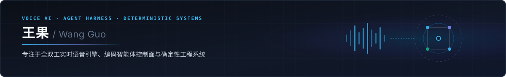

<picture>
  <source media="(prefers-color-scheme: dark)" srcset="./assets/header-dark.svg" />
  <source media="(prefers-color-scheme: light)" srcset="./assets/header-light.svg" />
  
</picture>

 

[-0084FF?style=flat-square&logo=zhihu&logoColor=white)](https://www.zhihu.com/people/wang-guo-ha-53)

---

### 🚀 核心开源作品与实验室

<table>
  <tr>
    <td width="50%" valign="top">
      <h4>🎙️ <a href="https://github.com/wangguode/hardcall">HardCall · 52ms 实时语音打断座舱</a></h4>
      
专治通用大模型“无限礼貌讨好”，面向全双工实时语音对抗与高压演练打造。

      <ul>
        <li><b>52ms 极速抢话打断</b>：端侧声学 VAD + 256 帧环形缓冲截断，0.16ms 硬件级清空残留尾音。</li>
        <li><b>双端架构与题库</b>：提供 Web 工作台与 Swift 6 原生 macOS 客户端，内置系统设计、薪资谈判与路演题库。</li>
      </ul>
      
<a href="https://hardcall.153557421.workers.dev">🌐 在线体验</a> · <a href="https://github.com/wangguode/hardcall">💻 GitHub 源码</a>

    </td>
    <td width="50%" valign="top">
      <h4>🧩 <a href="https://github.com/wangguode/zhishu-agent">zhishu-agent · 知枢智能体 Harness 架构</a></h4>
      
面向生产环境的通用编码智能体控制面：Java 17 (Spring Boot 3) 全栈工作台 + Python 零依赖模式库。

      <ul>
        <li><b>单测驱动自愈闭环</b>：自动捕获编译/测试报错并收敛修复代码，杜绝“改完不测直接交差”。</li>
        <li><b>企业级工程底座</b>：PreToolUse 三档安全拦截、两级 <code>/compact</code> 上下文压缩（省 85%+ Token）与标准 MCP。</li>
      </ul>
      
<a href="https://github.com/wangguode/zhishu-agent">💻 GitHub 源码</a>

    </td>
  </tr>
  <tr>
    <td width="50%" valign="top">
      <h4>📊 <a href="https://github.com/wangguode/statementflow-ai">StatementFlow AI · 确定性财务平账引擎</a></h4>
      
结合 AI 语义提取与 TypeScript 确定性复式记账核验的对账平台，彻底杜绝大模型算术幻觉。

      <ul>
        <li><b>分币不差双模核验</b>：内置零 Key 正则启发式解析，严格校验 <code>期初 + 贷方 - 借方 = 期末</code>（精确至 $0.01）。</li>
        <li><b>防公式注入导出</b>：自动转义 <code>=</code>、<code>+</code>、<code>-</code>、<code>@</code> 高危前缀，安全导出多工作表 Excel 与 CSV。</li>
      </ul>
      
<a href="https://statementflow-ai.153557421.workers.dev">🌐 在线使用</a> · <a href="https://github.com/wangguode/statementflow-ai">💻 GitHub 源码</a>

    </td>
    <td width="50%" valign="top">
      <h4>📚 <a href="https://github.com/wangguode/ai-agent-voice">ai-agent-voice · 语音网关与架构实验室</a></h4>
      
沉淀 100+ 篇体系化架构专栏与可运行代码实验室，涵盖实时语音网关、Agent 七层架构与 RAG 评测。

      <ul>
        <li><b>60ms 电信级 RTP 打断实验室</b>：FreeSWITCH 8kHz 裸流直连 + SOXR VHQ 无损重采样 + SenseVoice 语义打断。</li>
        <li><b>全景工程实战</b>：完整收录 Loop 收敛工程学、上下文工程与高并发架构演进代码。</li>
      </ul>
      
<a href="https://github.com/wangguode/ai-agent-voice/tree/main/01-voice-agent-rtp-bargein">🧪 RTP 打断实验室</a> · <a href="https://github.com/wangguode/ai-agent-voice">💻 GitHub 源码</a>

    </td>
  </tr>
</table>

---

### 📝 知乎精选深度专栏（[@王果ai](https://www.zhihu.com/people/wang-guo-ha-53)）

| 领域 | 代表作 |
| :--- | :--- |
| **Harness 工程学** | 🔥 [Harness Engineering 和 Loop Engineering —— 一部 Agent 工程的血泪史 (470+ 赞)](https://zhuanlan.zhihu.com/p/2051682264325546663) |
| **Loop 状态收敛** | 🔥 [Graph Engineering 刷屏了，但先问一个问题：你的 Agent Loop 收敛过吗？](https://zhuanlan.zhihu.com/p/2064476217709949350) |
| **实时语音网关** | 🎙️ [Agent-语音机器人篇(5)：Voice Agent 全栈架构深度解析](https://zhuanlan.zhihu.com/p/2081779542469906860) |
| **协议与技能体系** | 🧠 [从“能聊”到“能干”：深度拆解 Function Calling、MCP 与 Anthropic Skills 的演进之路](https://zhuanlan.zhihu.com/p/78345307884) |
