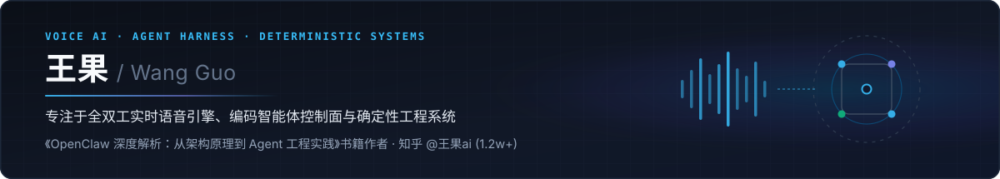
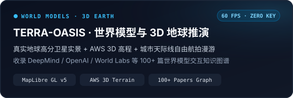
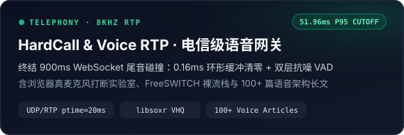
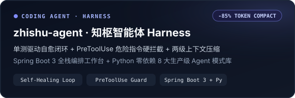
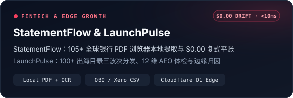
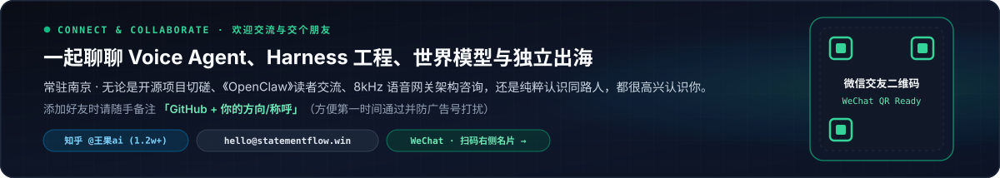

<picture>
  <source media="(prefers-color-scheme: dark)" srcset="./assets/hero-dark.svg" />
  <source media="(prefers-color-scheme: light)" srcset="./assets/hero-light.svg" />
  
</picture>

  <a href="https://terra.statementflow.win"><strong>🌍 TERRA-OASIS 世界模型</strong></a>
  &nbsp;·&nbsp;
  <a href="https://hardcall.statementflow.win"><strong>🎙️ HardCall 52ms 语音网关</strong></a>
  &nbsp;·&nbsp;
  <a href="https://statementflow.win"><strong>📊 StatementFlow 平账工作台</strong></a>
  &nbsp;·&nbsp;
  <a href="https://pulse.statementflow.win"><strong>🚀 LaunchPulse 出海增长</strong></a>
  &nbsp;·&nbsp;
  <a href="https://www.zhihu.com/people/wang-guo-ha-53"><strong>📖 知乎 @王果ai (1.2w+)</strong></a>
  &nbsp;·&nbsp;
  <a href="mailto:hello@statementflow.win"><strong>✉️ hello@statementflow.win</strong></a>

---

### 核心工程矩阵 · Flagship Systems

<table>
  <tr>
    <td width="50%" valign="top">
      <a href="https://terra.statementflow.win">
        <picture>
          <source media="(prefers-color-scheme: dark)" srcset="./assets/card-terra-dark.svg" />
          <source media="(prefers-color-scheme: light)" srcset="./assets/card-terra-light.svg" />
          
        </picture>
      </a>
      

        <a href="https://terra.statementflow.win"><strong>🌐 在线漫游体验</strong></a>
        &nbsp;·&nbsp;
        <a href="https://github.com/wangguode/terra-world-travel"><strong>📦 GitHub 源码</strong></a>
      

    </td>
    <td width="50%" valign="top">
      <a href="https://hardcall.statementflow.win">
        <picture>
          <source media="(prefers-color-scheme: dark)" srcset="./assets/card-voice-dark.svg" />
          <source media="(prefers-color-scheme: light)" srcset="./assets/card-voice-light.svg" />
          
        </picture>
      </a>
      

        <a href="https://hardcall.statementflow.win"><strong>⚡ 52ms vs 920ms 实测台</strong></a>
        &nbsp;·&nbsp;
        <a href="https://github.com/wangguode/ai-agent-voice"><strong>☎️ 8kHz RTP 架构库</strong></a>
      

    </td>
  </tr>
  <tr>
    <td width="50%" valign="top">
      <a href="https://github.com/wangguode/zhishu-agent">
        <picture>
          <source media="(prefers-color-scheme: dark)" srcset="./assets/card-zhishu-dark.svg" />
          <source media="(prefers-color-scheme: light)" srcset="./assets/card-zhishu-light.svg" />
          
        </picture>
      </a>
      

        <a href="https://github.com/wangguode/zhishu-agent"><strong>🧩 知枢 Harness 源码</strong></a>
        &nbsp;·&nbsp;
        <a href="https://dev.to/wangguode/self-healing-coding-agents-how-to-build-a-production-grade-harness-loop-with-mcp-48i9"><strong>📑 架构拆解 (EN)</strong></a>
      

    </td>
    <td width="50%" valign="top">
      <a href="https://statementflow.win">
        <picture>
          <source media="(prefers-color-scheme: dark)" srcset="./assets/card-saas-dark.svg" />
          <source media="(prefers-color-scheme: light)" srcset="./assets/card-saas-light.svg" />
          
        </picture>
      </a>
      

        <a href="https://statementflow.win"><strong>📊 StatementFlow AI</strong></a>
        &nbsp;·&nbsp;
        <a href="https://pulse.statementflow.win"><strong>🚀 LaunchPulse 控制台</strong></a>
      

    </td>
  </tr>
</table>

---

### 出版专著与知乎深度专栏 · Book & Selected Essays

- **出版专著**：**《OpenClaw 深度解析：从架构原理到 Agent 工程实践》**（清华大学出版社）—— 系统拆解生产级编码智能体的状态循环、上下文压缩、工具权限沙盒与多智能体编排工程实践。
- **知乎技术专栏**（[**@王果ai**](https://www.zhihu.com/people/wang-guo-ha-53) · **1.2w+ 关注** · 持续输出可落地的硬核工程拆解）：

| 研究专题 | 代表深度长文 |
| :--- | :--- |
| **Harness 工程学** | [Harness Engineering 和 Loop Engineering —— 一部 Agent 工程的血泪史（480+ 赞）](https://zhuanlan.zhihu.com/p/2051682264325546663) |
| **Loop 状态收敛** | [Graph Engineering 刷屏了，但先问一个问题：你的 Agent Loop 收敛过吗？](https://zhuanlan.zhihu.com/p/2064476217709949350) |
| **实时语音网关** | [Agent-语音机器人篇(5)：Voice Agent 全栈架构深度解析（8kHz RTP / VAD / 打断）](https://zhuanlan.zhihu.com/p/2081779542469906860) |
| **协议与技能体系** | [从“能聊”到“能干”：深度拆解 Function Calling、MCP 与 Anthropic Skills 的演进之路](https://zhuanlan.zhihu.com/p/78345307884) |

---

### 开源仓库全览 · Open-Source Index

| 仓库 | 技术方向 | 核心工程能力与在线入口 |
| :--- | :--- | :--- |
| [**terra-world-travel**](https://github.com/wangguode/terra-world-travel) | `World Models` `3D WebGL` | MapLibre GL v5 + Esri 全球卫星 + AWS 3D 高程 60 FPS 漫游器 + 100+ 世界模型文献图谱 · [在线体验](https://terra.statementflow.win) |
| [**ai-agent-voice**](https://github.com/wangguode/ai-agent-voice) | `8kHz RTP` `FreeSWITCH` | 100+ 篇语音智能体实战长文与 `<60ms` 裸 RTP + `libsoxr` VHQ 打断实验室 · [RTP 源码](https://github.com/wangguode/ai-agent-voice/tree/main/01-voice-agent-rtp-bargein) |
| [**hardcall**](https://github.com/wangguode/hardcall) | `WebAudio VAD` `SIP/PSTN` | 51.96ms P95 语音打断基准测试台（真麦克风 RMS VAD vs 920ms WebSocket 对比） · [在线实验室](https://hardcall.statementflow.win) |
| [**zhishu-agent**](https://github.com/wangguode/zhishu-agent) | `Agent Harness` `MCP` | Spring Boot 3 控制面 + Python 8 大模式库：单测自愈闭环、PreToolUse 拦截与 `-85%` 上下文压缩 |
| [**statementflow-ai**](https://github.com/wangguode/statementflow-ai) | `FinTech` `Local PDF` | 105+ 全球银行 PDF 零上传本地提取、扫描件 Vision OCR 与 `$0.00` 复式平账导出 · [在线工作台](https://statementflow.win) |
| [**launchpulse**](https://github.com/wangguode/launchpulse) | `AEO` `Edge Attribution` | 出海 SaaS 100+ 目录三波次节奏分发、12 维 `/llms.txt` 诊断与亚 10ms 边缘归因 · [在线控制台](https://pulse.statementflow.win) |
| [**llm-prod-bench**](https://github.com/wangguode/llm-prod-bench) | `LLM Eval` `Benchmark` | 面向生产环境的 LLM 延迟、吞吐、结构化输出稳定性与工具调用评测套件 |
| [**ai-wig-tryon-platform**](https://github.com/wangguode/ai-wig-tryon-platform) | `Multimodal` `Spring Boot` | React 19 + Spring Boot 3 多模态视觉大模型动态路由与虚拟试戴全栈架构 |

---

### 交个朋友 · Connect & Collaborate

<picture>
  <source media="(prefers-color-scheme: dark)" srcset="./assets/connect-dark.svg" />
  <source media="(prefers-color-scheme: light)" srcset="./assets/connect-light.svg" />
  
</picture>

