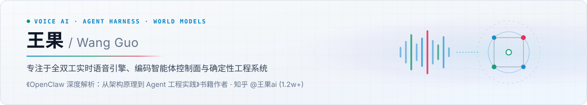

<picture>
  <source media="(prefers-color-scheme: dark)" srcset="./assets/hero-dark.svg" />
  <source media="(prefers-color-scheme: light)" srcset="./assets/hero-light.svg" />
  
</picture>

 

**[TERRA-OASIS 世界模型](https://terra.statementflow.win)** &nbsp;·&nbsp; **[HardCall 语音网关](https://hardcall.statementflow.win)** &nbsp;·&nbsp; **[StatementFlow AI](https://statementflow.win)** &nbsp;·&nbsp; **[LaunchPulse](https://pulse.statementflow.win)** &nbsp;·&nbsp; **[知乎 @王果ai](https://www.zhihu.com/people/wang-guo-ha-53)** &nbsp;·&nbsp; **[Email](mailto:hello@statementflow.win)**

---

### 关于我

- **前沿探索**：持续深耕 **世界模型（World Models）** 架构与 Web 3D 真实地球交互推演（[`TERRA-OASIS`](https://terra.statementflow.win)）
- **工程方向**：全双工实时语音网关（8kHz RTP / FreeSWITCH）、生产级编码智能体 Harness 架构、确定性 FinTech 财务平账引擎
- **技术专著**：《OpenClaw 深度解析：从架构原理到 Agent 工程实践》（清华大学出版社）
<!-- 后续新增专著可直接在此追加，或并入技术专著行 -->

---

### 核心开源项目

<table>
  <thead>
    <tr>
      <th align="left" width="150">项目</th>
      <th align="left" width="1000">核心定位与工程指标</th>
    </tr>
  </thead>
  <tbody>
    <tr>
      <td><a href="https://github.com/wangguode/terra-world-travel"><strong>TERRA-OASIS</strong></a></td>
      <td><strong>真实地球 3D 卫星地形漫游器 &amp; 世界模型研究台</strong> — MapLibre GL v5 + Esri 全球卫星 + AWS 3D 高程 + OpenFreeMap 3D 建筑，零 API Key 60 FPS 航拍全球地标，内置 100+ 篇 World Models 前沿文献知识图谱（<a href="https://terra.statementflow.win">在线体验</a> · <a href="https://terra.statementflow.win/research">文献图谱</a>）。</td>
    </tr>
    <tr>
      <td><a href="https://github.com/wangguode/zhishu-agent"><strong>zhishu-agent</strong></a></td>
      <td><strong>知枢智能体 Harness 架构</strong> — Spring Boot 3 全栈工作台 + Python 零依赖 8 大模式库；单测自愈闭环、PreToolUse 边界拦截与两级 <code>/compact</code> 上下文压缩（省 85%+ Token）。</td>
    </tr>
    <tr>
      <td><a href="https://github.com/wangguode/ai-agent-voice"><strong>ai-agent-voice</strong></a></td>
      <td><strong>电信级语音网关与架构实验室</strong> — 100+ 篇体系化架构长文与可运行代码实验室，含 FreeSWITCH 8kHz 裸流 + SOXR VHQ 重采样 60ms RTP 打断实现（<a href="https://github.com/wangguode/ai-agent-voice/tree/main/01-voice-agent-rtp-bargein">RTP 实验室</a>）。</td>
    </tr>
    <tr>
      <td><a href="https://github.com/wangguode/hardcall"><strong>HardCall</strong></a></td>
      <td><strong>全双工语音打断模拟器 &amp; B2B 8kHz RTP 网关</strong> — 免费浏览器端打断演练 + 52ms vs 920ms 声波对比，面向企业提供 8kHz RTP / FreeSWITCH 私有化语音网关方案（<a href="https://hardcall.statementflow.win">在线体验</a>）。</td>
    </tr>
    <tr>
      <td><a href="https://github.com/wangguode/statementflow-ai"><strong>StatementFlow&nbsp;AI</strong></a></td>
      <td><strong>确定性财务平账与批量 PDF 提取引擎</strong> — 支持 105+ 全球银行格式；浏览器本地多 PDF 并发合并、扫描件 Vision OCR、<code>$0.00</code> 复式平账、原生 <code>.xlsx</code> 与 QuickBooks/Xero 一键导出（<a href="https://statementflow.win">在线使用</a> · <a href="https://statementflow.win/tools/quickbooks-csv-fixer">免费工具</a>）。</td>
    </tr>
    <tr>
      <td><a href="https://github.com/wangguode/launchpulse"><strong>LaunchPulse</strong></a></td>
      <td><strong>出海 SaaS 分发、AEO 诊断与边缘归因工作台</strong> — 100+ 高权软件目录 3 波次节奏化分发、外链 HTTP 200 与 <code>dofollow</code> 自动验活、24/7 社区买家雷达及亚 10ms Cloudflare 边缘追踪短链（<a href="https://pulse.statementflow.win">在线工作台</a> · <a href="https://pulse.statementflow.win/tools/aeo-checker">免费 AEO 检测</a>）。</td>
    </tr>
  </tbody>
</table>

---

### 知乎精选专栏（[@王果ai](https://www.zhihu.com/people/wang-guo-ha-53) · 1.2w+ 关注）

<table>
  <thead>
    <tr>
      <th align="left" width="150">方向</th>
      <th align="left" width="1000">代表文章</th>
    </tr>
  </thead>
  <tbody>
    <tr>
      <td><strong>Harness&nbsp;工程学</strong></td>
      <td><a href="https://zhuanlan.zhihu.com/p/2051682264325546663">Harness Engineering 和 Loop Engineering —— 一部 Agent 工程的血泪史</a></td>
    </tr>
    <tr>
      <td><strong>Loop&nbsp;状态收敛</strong></td>
      <td><a href="https://zhuanlan.zhihu.com/p/2064476217709949350">Graph Engineering 刷屏了，但先问一个问题：你的 Agent Loop 收敛过吗？</a></td>
    </tr>
    <tr>
      <td><strong>实时语音网关</strong></td>
      <td><a href="https://zhuanlan.zhihu.com/p/2081779542469906860">Agent-语音机器人篇(5)：Voice Agent 全栈架构深度解析</a></td>
    </tr>
    <tr>
      <td><strong>协议与技能体系</strong></td>
      <td><a href="https://zhuanlan.zhihu.com/p/78345307884">从“能聊”到“能干”：深度拆解 Function Calling、MCP 与 Anthropic Skills 的演进之路</a></td>
    </tr>
  </tbody>
</table>

---

### 微信交流

<table width="100%">
<tr>
<td width="1000" valign="middle">

欢迎交流开源项目、世界模型、Voice Agent / Harness 架构与独立出海。 
邮箱 [hello@statementflow.win](mailto:hello@statementflow.win) &nbsp;·&nbsp; 添加好友请备注 **「GitHub + 方向 / 称呼」**

</td>
<td width="140" align="center" valign="middle">

</td>
</tr>
</table>
